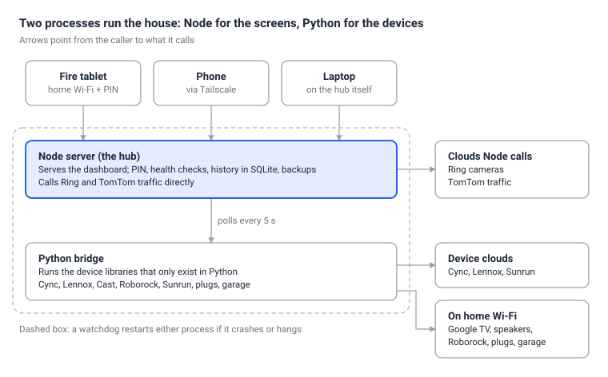

### I Built My Own Home Hub (and Learned Why Smart Homes Are Hard)
I built a single dashboard for my whole house in a weekend, and the dashboard was the easy part. My home runs on Ring cameras, GE Cync light switches, a Lennox thermostat, Google Cast speakers and TVs, a Roborock vacuum, Smart Life plugs and Sunrun solar. Each one came with its own app, its own login and its own idea of what "home" means.

To turn off the lights, check the doorbell and see whether the AC was running, I opened three apps. I wanted one screen on the wall that showed everything and controlled most of it, without a subscription and without sending more of my life to yet another cloud.

So I built one with Claude Code as my pair programmer. This is what came out of it, what broke along the way, and what I learned about why smart homes are still so fragmented.

### What It Does Today
The hub now covers 20 devices from seven brands on one page, plus the weather and a photo screen when nobody is touching it.

| Area | Devices | What the dashboard does | How it connects |
| --- | --- | --- | --- |
| Cameras | Ring cameras | Snapshots, motion and doorbell alerts | Ring cloud |
| Lights | 10 GE Cync switches | On/off and dimming, live status | Cync cloud |
| Climate | Lennox iComfort M30 | Temperature, humidity, mode, setpoint, 24-hour chart | Lennox cloud |
| Media | Google Cast speakers and TVs | Now playing, volume, play/pause, TV power | Local network |
| Cleaning | Roborock Q5 | Start, pause, dock, battery | Local network |
| Energy | Sunrun solar | Yesterday's production, 7-day, 30-day and yearly totals | Sunrun portal API |
| Plugs | Smart Life (Tuya) plugs | On/off and power use (waiting on keys) | Local network |
| Garage | Chamberlain opener | Open, close, light (waiting on hardware) | Local add-on board |

On top of the devices, the dashboard has a clock, today's and tomorrow's weather with sunrise and sunset, an Activity log of everything that happened, and a weekday-morning commute card with live traffic.

### How It's Built
The hub is two small programs on one computer: a Node.js server that runs the dashboard, and a Python bridge for the devices whose libraries only exist in Python.

Screens only ever talk to the Node server, which polls the bridge every five seconds and pushes changes to every open screen as they happen.

The dashboard itself is plain HTML, CSS and JavaScript with no framework. Each device type has a card that updates in place, so a slider you are dragging isn't redrawn under your finger. Each brand is an adapter with the same small contract: list its devices, change a device's state, and report whether it's healthy.

### War Stories: Where the Time Actually Went
The dashboard took an evening. Most of the weekend went to vendors whose devices only half want to be talked to.

- **Cync: one missing light froze all ten.** The dashboard showed every light as off while two were on. One switch existed on the Bluetooth mesh but not in my account's device list, so the library skipped it. Worse, Cync sends every light's status in one message, and the library threw the whole message away when it met that unknown switch. The fix was to add mesh-only devices and skip unknown entries instead of rejecting the batch.
- **Lennox: logged in, but silence.** The thermostat's cloud login worked and reported the system online, yet sent zero data. It turned out Lennox's cloud only delivers messages to app IDs in its own secret format; a made-up ID logs in fine and gets nothing forever. A second bug waited behind it: the code called a property as a function, which would have crashed the moment data arrived.
- **Roborock: a Windows-only crash.** The vacuum never connected, with no useful error. Its messaging library needs a networking feature that Python's default event loop on Windows doesn't implement. One line switching the event loop fixed it, and the vacuum then connected locally, without the cloud.
- **Sunrun: no live solar, ever.** I hoped for "making 3.2 kW right now". The panels' meter uploads once a day, overnight, over its own cellular modem, so the best possible is yesterday's curve at 15-minute detail. The sign-in also expires every 24 hours, which I'm still solving.
- **myQ: locked out by design.** Chamberlain closed its garage API to third parties in 2023. The only clean route is a small local board wired to the opener's wall-button terminals, so the code is ready and waiting for the hardware.
- **Google TV: turning off a TV that isn't on the network.** Cast can play and pause but can't power anything off. The Chromecast with Google TV accepts the remote's power key over its own pairing protocol, then switches the TV over HDMI-CEC. A one-time code on the screen, and the dashboard got a working power button.

The pattern: the bug was rarely in my code. It was in an unofficial library, a vendor's undocumented rule, or a platform difference nobody had hit before.

### Making It Something the Family Can Rely On
A dashboard that works on my laptop is a demo; one my family uses every day needs to recover on its own and keep strangers out.

| Piece | What it does | Tested by |
| --- | --- | --- |
| Watchdog | Restarts the hub if it crashes or stops answering, with backoff | Killing the server: back in 8 seconds |
| Bridge restart | Restarts the Python side if it dies | Killing it: back in 2 seconds |
| Health banner | Names any broken integration on the dashboard ("Solar: session expired") | Pointing it at a device that doesn't exist |
| History | Readings every 5 minutes and events as they happen, kept for a year, in SQLite | Pretend devices in a throwaway database |
| Backups | Daily copy of every login and the history, last 14 days kept | Checking the first day's files |
| PIN | Devices on home Wi-Fi enter a PIN once; only a salted hash is stored | Wrong PIN, right PIN, forged cookie, lockout after 5 tries |
| Tailscale | Private access from my phone anywhere, nothing exposed to the internet | Opening it on my phone over cellular |

The Tailscale piece surprised me most. With one command, the hub got a private HTTPS address that only my family's devices can open, from anywhere, without touching the router.

### The Wall Display
An old Amazon Fire tablet became the screen on the wall, running the dashboard full-screen in a kiosk browser. I first wondered whether the tablet could run the hub itself; it can't, because Fire OS stops long-running background apps and the tablet is too slow, but it makes a perfect display.

After three minutes untouched, or with one tap on the moon button, the dashboard switches to an idle screen:

- **A family photo** fills the background. On a landscape screen the whole portrait photo sits beside the clock, so no one gets cropped out.
- **Two weather cards**, today and tomorrow, each with the high, low, sunrise and sunset.
- **The morning commute** on weekdays from 6 to 10 AM, with live traffic and a stop along the way built into the route.

One tap brings the dashboard back. When the doorbell rings, the camera view opens on its own.

### Is It as Good as an Echo Show? Not Yet, but It Beats It at One Thing
The store-bought hubs win on voice, routines and polish. Mine wins on reach: an Echo Show is great with Ring, a Nest Hub with Cast, Apple Home with HomeKit devices, but none of them puts all my brands side by side, and mine has no ads, no subscription and no microphone.

The gap to something JARVIS-like is mostly buildable on what's there:

- **Alerts** to our phones (garage left open, dishes done, a camera battery running low), through a Telegram bot.
- **Routines** like bedtime, away mode when both phones leave, and a porch light at sunset.
- **Plain-language control and photo descriptions** using an AI model.

The last one has a price. I compared running Claude through its API with running a free model locally:

| Option | Monthly cost | Reality on my hardware |
| --- | --- | --- |
| Claude Haiku via API | About $1.50 | Fast; good enough for commands and doorbell photo descriptions |
| Claude Sonnet or Opus via API | About $12 to $25 | Smarter for open-ended questions; not needed for most of this |
| Local model on my 2017 laptop | Free | 20 to 60 seconds per answer, about a minute per photo |

The laptop has two cores, no graphics card and 16 GB of memory, so local AI waits for better hardware. For now the plan is Haiku with a monthly spending cap, added after the free features.

### Lessons Learned
1. **The UI is the easy part.** Every hour went into vendor quirks, not buttons and cards.
2. **Unofficial APIs break quietly.** Cync, Lennox and Sunrun all failed without a clear error, which is why the health banner came before any new feature.
3. **Local beats cloud whenever a device allows it.** The TV, vacuum and plugs answer in milliseconds and keep working when a vendor's servers don't.
4. **Buy for openness next time.** Devices that support Matter, or that publish a local API, would have saved most of the war stories.
5. **An AI pair programmer changes what a weekend can hold.** It wrote most of the code and ran the tests, but the decisions stayed mine: what to protect with a PIN, what not to send to the cloud, what was worth paying for.
6. **A laptop is a fine start and a poor home.** The hub stops when the laptop sleeps, so its next home is a spare always-on machine.
